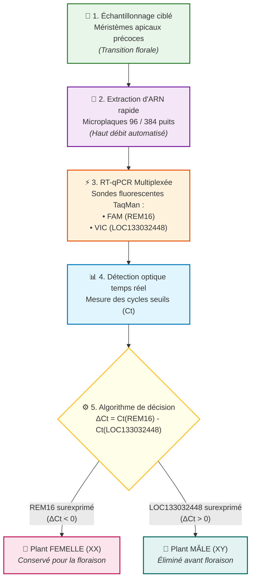

# Proposition de différenciation sexuelle à haut débit

À la suite de l’analyse des données transcriptomiques des plants de cannabis, je présente une méthode d’analyse potentielle pouvant être utilisée avec des outils à haut débit. En effet, le gène REM16 (LOC115699937) est surexprimé chez les femelles, alors que le gène LOC133032448 est surexprimé chez les mâles. Il suffirait donc de détecter la surexpression de REM16 par rapport à LOC133032448 pour identifier les femelles, ou sa sous-expression pour identifier les mâles. Toutefois, il sera important de prélever des tissus floraux ou des méristèmes apicaux chez les spécimens, car REM16 et LOC133032448 semblent être exprimés de manière différentielle dans ce type de tissu. En effet, les données précédentes ont montré que, chez nos individus, un autre facteur principal de l’ACP les divisait en deux catégories. Les hypothèses les plus probables sont liées au type de tissu (floral ou non floral) ou à la maturité du plant (croissance ou reproduction). Il est donc important de ne prélever que des tissus méristématiques floraux sur des individus relativement âgés. Afin de détecter et de quantifier ces transcrits à grande échelle, une analyse de RT-qPCR multiplexée en microplaques peut être réalisée à faible coût avec un équipement automatisé. Enfin, un pipeline d'analyse statistique simple calculera le ratio d'expression relative à partir des signaux de fluorescence distincts émis par les sondes REM16 et LOC133032448 dans chaque puits, nous permettant ainsi de classer automatiquement et avec certitude chaque individu comme mâle ou femelle, et ce, avant même d’obtenir une floraison mature. 

### Pictogramme du pipeline proposé

